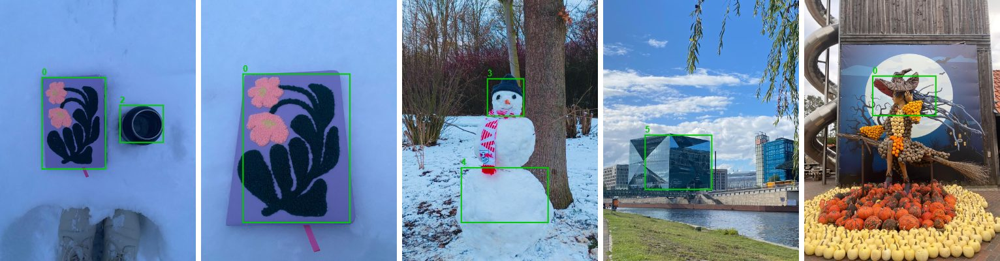

# YOLO Annotation Toolkit

A small OpenCV tool to draw, review, visualise and **quality-check** bounding-box labels in YOLO format, the input format for training object-detection models.

[](https://github.com/Sachinisand/YOLO-DataOps-Toolkit/actions/workflows/tests.yml)



## What it does

| Command | Purpose |
|---|---|
| `annotate` | Draw boxes in an OpenCV window. Existing labels are loaded, so you can resume or correct earlier work. |
| `review` | Same window, but reads labels from one folder and saves to another (keeps the original labels). |
| `visualize` | Writes copies of the images with the boxes drawn, for a quick visual check. |
| `check` | Data-quality report: boxes per class, images without labels, labels without images, unreadable lines, zero-size boxes, boxes outside the image, unknown class ids. Exit code 1 if anything is wrong, so it can run in a pipeline. |

## Quick start

```bash
pip install -r requirements.txt

python src/yolo_manager.py check     --img_dir data/images --lbl_dir data/annotated_labels
python src/yolo_manager.py visualize --img_dir data/images --lbl_dir data/annotated_labels --save_dir data/visualizations
python src/yolo_manager.py annotate  --img_dir data/images --lbl_dir data/annotated_labels
```

`check` on the sample data finds one real problem:

```
images: 5 | with labels: 5 | boxes: 8
boxes per class: 0: 3, 2: 1, 3: 1, 4: 1, 5: 2
  zero-size box   4.txt box 1
1 problem(s) found
```

That box (width and height 0) came from a click without a drag in the first version of the tool. A model training pipeline would accept it silently. The current version ignores clicks shorter than 3 pixels, and `check` catches any that already exist. Add `--report issues.csv` to save the list, or `--classes 6` to flag class ids outside 0–5.

## Annotation window

| Key / mouse | Action |
|---|---|
| left drag | draw a box (any direction) |
| right click | select the box under the cursor (the smallest one, if boxes overlap) |
| `0`–`9` | class for new boxes; also changes the selected box |
| `x` / `c` | delete selected box / clear all |
| `u` / `y` | undo / redo |
| `+` / `-` | zoom in / out at the cursor |
| arrow keys | pan |
| `r` | reset zoom, pan, brightness and contrast |
| `q` / `s` / `Esc` | save and next / skip without saving / save and stop |
| `h` | hide or show the help text |

Brightness and contrast sliders only change the display, not the image.

## Label format

One `.txt` per image with the same name. One line per box, all values relative to the image size (0–1):

```
<class_id> <x_center> <y_center> <width> <height>
0 0.376904 0.472381 0.324873 0.350476
```

An empty file means "this image has no objects", which is valid YOLO.

## Bugs found and fixed in version 2

Version 2 is a rewrite that fixes these problems in version 1. Each fix has a test in `tests/test_core.py`:

| Problem in version 1 | Effect | Fix |
|---|---|---|
| Boxes drawn while zoomed in were stored in screen coordinates | Labels shifted to the wrong place | Boxes are always kept in image pixels; a `View` converts screen ↔ image |
| Drawing from bottom-right to top-left | Negative width/height in the label file | Corners are sorted and clipped to the image |
| One undo removed two actions | Lost work | Undo stores a snapshot before each change |
| A click without a drag | Zero-size box (still in the sample data, see above) | Minimum box size, plus the `check` command |
| Default image format `png`, sample images are `.jpeg` | README commands found 0 images | All common image types are found |
| Review mode used different keys and could not add boxes | Two inconsistent tools | Review uses the same window as annotate |
| Arrow-key codes only worked on Linux | No panning on Windows | Key codes for Linux, Windows and macOS |

## Tests

```bash
pip install -r requirements-dev.txt
pytest -q
```

13 tests cover the coordinate conversion, zoom and pan, undo/redo, selection and the dataset check. They need no window. GitHub Actions runs them, and the `check` command on the sample data, on every push.

## Project structure

```
├── src/
│   ├── yolo_core.py       ← box maths, zoom/pan, undo, dataset check (no GUI, tested)
│   └── yolo_manager.py    ← OpenCV window and command line
├── tests/test_core.py
├── data/
│   ├── images/            ← 5 sample photos
│   ├── annotated_labels/  ← their YOLO labels
│   └── preview.jpg        ← output of the visualize command (used above)
```

## Limitations

- Class ids are numbers 0–9; there is no class-name file yet.
- One image at a time, no keyboard shortcut to go back to the previous image (run `annotate` again: saved labels are loaded).
- The sample set is 5 photos, only to demonstrate the tool, not a training dataset.

---

**Author:** Sachini Hewahattage · [LinkedIn](https://www.linkedin.com/in/sachini-hewahattage) · [GitHub](https://github.com/Sachinisand)
